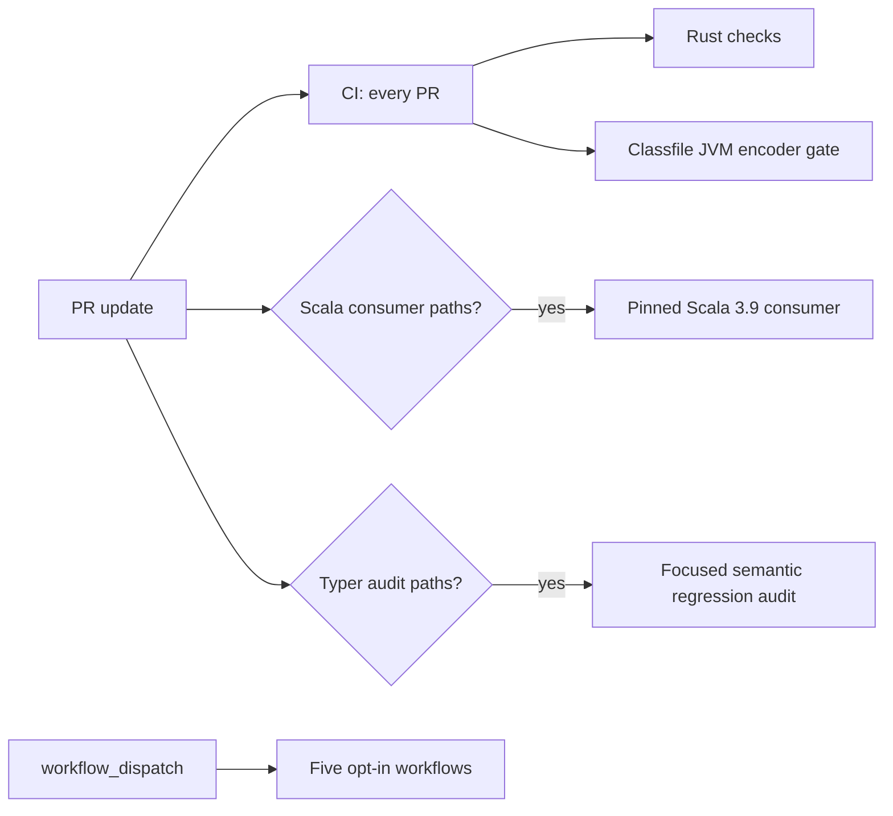

# CI critical-path and DAG assessment (#1740)

Measurements and repository policy below were checked on 2026-10-27. Run
durations are observations from the linked GitHub Actions runs, not an SLO or a
performance distribution unless a sample count is stated.

## Current workflow inventory

The repository has eight workflows. Three participate in pull requests; five
are manual diagnostics or compatibility runs. Only the applicable PR workflows
belong to the PR-to-green critical path.

| Workflow | Trigger and PR role | Jobs | Concurrency policy |
| --- | --- | --- | --- |
| [CI](../.github/workflows/ci.yml) | Push to `main`, every PR to `main`, or manual dispatch. PR gate for all changes. | `Rust checks` and `Classfile JVM encoder gate`, independent and parallel. | Same workflow/ref group; cancel older runs. |
| [JVM TASTy factory Scala consumer](../.github/workflows/jvm-tasty-factory-scala-consumer.yml) | PRs matching its broad source/test/fixture paths, or manual dispatch. | One pinned Scala/JVM consumer job. | Cancel older PR runs; do not cancel manual runs. |
| [Typer focused audit](../.github/workflows/typer-focused-audit.yml) | PRs matching typer/classloader/TASTy/audit paths, or manual dispatch. | One focused deterministic audit job. | Do not cancel an in-progress run. |
| [Typer full corpus audit](../.github/workflows/typer-full-corpus-audit.yml) | Manual dispatch with an explicit `run-full-audit` opt-in. | One conditional, two-pass audit job. | Do not cancel an in-progress run. |
| [Lexer compatibility](../.github/workflows/lexer-compatibility.yml) | Manual dispatch, with fixture/source/all corpus choices. | One Scala lexer comparison job. | Cancel an older run on the same ref. |
| [Scala parser oracle](../.github/workflows/parser-oracle.yml) | Manual dispatch only. | One differential parser job. | Cancel an older run on the same ref. |
| [TASTy compatibility](../.github/workflows/tasty-compatibility.yml) | Manual dispatch, with all/library/compiler corpus choices. | One structured round-trip job. | Cancel an older run on the same ref. |
| [CI Cargo compile timings](../.github/workflows/ci-cargo-timings.yml) | Manual diagnostic; compile-only or full Rust checks. | One measurement job. | Do not cancel an in-progress run. |

For a PR, `CI` always starts. The Scala consumer and focused Typer audit join
the DAG only when their path filters match:

The PR critical path is measured from the earliest applicable workflow creation
to the latest applicable check completion. It is the maximum elapsed path, not
the sum of jobs that run in parallel. Manual runs are excluded. The PR workflow
checks have no `needs` edges between them.

The active default-branch ruleset (checked through the GitHub API on this date)
contains only `non_fast_forward`; it defines **no required status-check names**.
The existing `Rust checks`, `Classfile JVM encoder gate`, Scala consumer, and
focused-audit names are left unchanged. No trigger, path filter, success
condition, or coverage is weakened.

## Main CI critical-path baseline

The most comparable adjacent baseline is the final #1739 PR run, whose only
final-head change was documentation. Its [CI run](https://github.com/scytrowski/dotty-rs/actions/runs/40469572381)
was created at 07:50:39 UTC and completed at 07:59:34 UTC:

| Job | Wall time | Notable steps |
| --- | ---: | --- |
| `Rust checks` | 8m52s | The serial test command occupied 7m52s and began 58s after the job started. Clippy took 23s; rustdoc took 10s. |
| `Classfile JVM encoder gate` | 3m02s | Includes the separate stable Rust toolchain and required JDK verification. |
| CI PR critical path | 8m55s | From workflow creation to the last job. |
| Sum of CI job wall times | 11m54s | Runner-wall-time proxy for runner minutes, before billing rounding. |

The test command is the longest step, but Clippy and rustdoc already run in the
same job and rustdoc reuses dev-profile outputs from Clippy. The test profile
does not reuse the dev-profile units. The focused Cargo timing and profile data
in the [#1735 baseline](ci-performance-baseline.md#rust-test-compilation-and-linking-profile-1737)
records a 6m50s median for the full test step before the later run above, and
shows that switching test `opt-level` to 0 fails an existing stack-depth test.
The [#1736 comparison](ci-performance-baseline.md#same-commit-full-rust-check-comparison)
also found a 6m47s median full Rust-check job with dependency-only caching (three
runs, 5m51s–7m16s). These ranges make a one-run, few-seconds change insufficient
evidence of a stable improvement.

After #1738's Scala build cache, the final update in that PR had Rust checks
finish at 07:31:26 UTC, the pinned Scala consumer at 07:27:37, and the JVM gate
at 07:24:15. From the common 07:22:23 run creation, the critical path was 9m03s;
the job wall-time sum was 16m03s. The Scala consumer's warm job took 5m12s. This
shows that the main Rust checks, rather than Scala staging, were the critical
path on that update.

## Candidate DAG measurement and decision

I measured one candidate that moved workflow lint, formatting, frontend
boundaries, Clippy, rustdoc, and diff checking to a parallel `Rust quality
checks` job while preserving `Rust checks` as the test job. The exact test and
quality commands remained unchanged. Hosted actionlint/workflow lint and every
job passed on the candidate [CI run](https://github.com/scytrowski/dotty-rs/actions/runs/40471315938).

| Layout | Run | Rust tests/checks | Rust quality | JVM gate | CI critical path | Sum of job wall times |
| --- | --- | ---: | ---: | ---: | ---: | ---: |
| Existing serial Rust checks | [40469572381](https://github.com/scytrowski/dotty-rs/actions/runs/40469572381) | 8m52s | Included | 3m02s | 8m55s | 11m54s |
| Parallel candidate | [40471315938](https://github.com/scytrowski/dotty-rs/actions/runs/40471315938) | 8m41s | 54s | 2m58s | 8m45s | 12m33s |

The candidate reduced observed critical path by 10s, while adding 39s of total
job wall time (about 5.5%). Its test command alone took 8m20s, 28s longer than
the baseline test step; the sample is too small to claim a stable latency gain.
The new job also repeats checkout, toolchain setup, cache setup, and runner
startup. The observed latency change is within the existing 85s warm full-job
range, and the runner-time sum is worse. I therefore **rejected the split** and
reverted it in the final diff. This is one candidate observation, not a new
distribution; the evidence does not justify an always-on extra runner.

The current two-job CI DAG is retained. Both jobs remain parallel. Clippy and
rustdoc stay together because the recorded local sequence reused 30 dev-profile
units between those commands. The test-profile build remains separate and
optimized because the unoptimized profile fails the stack-depth test.

## Duplicate coverage, triggers, and concurrency

- The classfile/JVM target selection overlaps between the main JVM job and the
  Scala consumer's Java verifier. The environments are distinct: the main gate
  uses moving `stable` Rust and JDK 21, while the consumer pins Rust 1.98.1,
  JDK 21.0.8, and Scala source revision
  `777528f19a58e794c9954a42f433373472ec57f8`. Removing either loses verification
  under one of those intentionally different environments, so the gates remain.
- The Scala consumer's path filter remains broad across crates, integration
  tests, fixtures, lockfile/toolchain, and oracle inputs. Narrowing source paths
  risks skipping TASTy interoperability changes. The focused audit retains its
  existing typer/TASTy paths and deterministic baseline.
- The focused audit's PR and manual runs share a non-cancelling concurrency
  group. Recent PR updates for #1739 were separated by more than the focused
  job's observed runtime, so available history does not demonstrate a stale
  focused-run queue. I left this setting unchanged; manual full-corpus audits
  remain uninterrupted and opt-in.
- The Scala consumer already uses cancellation only for PR updates. Its earlier
  measured stale-run case had a newer run wait 8m19s from creation before
  starting while the older run finished; #1738 changed the PR policy while
  preserving non-cancelling manual runs. CI already cancels obsolete revisions.
- Lexer, parser, TASTy, Cargo timing, and full-corpus diagnostics remain
  manual; none was promoted to an automatic PR check. No hosted full-corpus
  Typer audit was run.

The candidate changed only `.github/workflows/ci.yml`, so hosted validation
exercised all default CI gates; path-filtered Scala and focused-Typer workflows
did not trigger. For a negative control, a temporary test
(`tests/ci_failure_probe_1740.rs`) was added in one PR update and removed before
the final head. In [run 40472697314](https://github.com/scytrowski/dotty-rs/actions/runs/40472697314),
that test panicked as intended, the unchanged `Run tests` step exited 101, the
`Rust checks` job failed, and the overall CI workflow concluded `failure`; the
separate Classfile JVM gate passed. The `tests/**` change also triggered the
pinned Scala consumer path filter, which passed in
[run 40472697370](https://github.com/scytrowski/dotty-rs/actions/runs/40472697370).
This verifies that a failing test remains visible and that relevant tests-path
edits select the Scala consumer.

The final workflow has no `continue-on-error` or conditional success shortcut;
any failed job makes CI fail. The temporary probe is absent from the final PR
diff. The workflow layout remains unchanged because the measured split did not
produce a net benefit.
