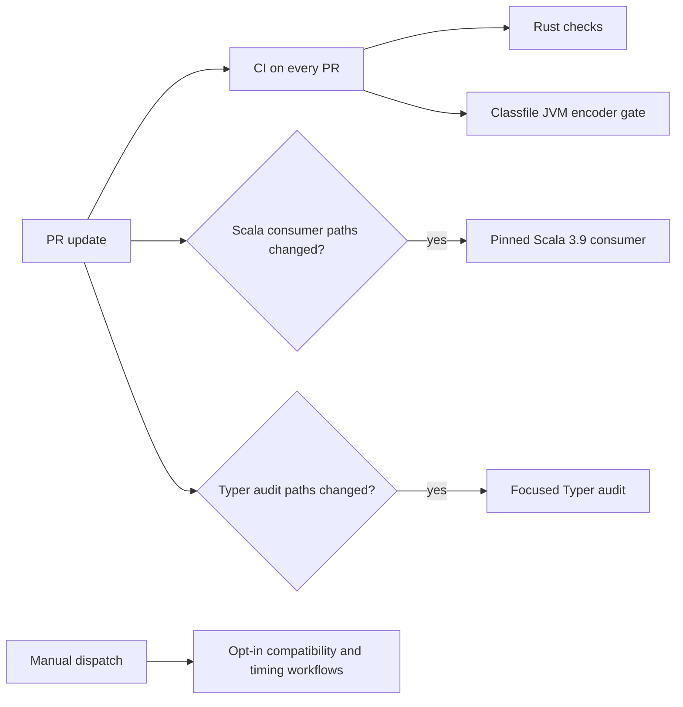

# CI performance results and regression audit (#1741)

Recorded 2026-10-27 after the #1735–#1740 CI optimization sequence. This report consolidates the published baseline and controlled experiments; it does not define an SLO. GitHub Actions elapsed time includes runner queue unless the source explicitly reports job wall time. All reported changes retained the existing semantic and compatibility gates.

## Findings

- The strongest repeatable gain is the main Rust checks cache change: on the same commit, toolchain, runner image, and full workload, three warm dependency-cache runs reduced median Rust-job wall time from 10m38s to 6m47s (3m51s, 36%). The restored archive fell from 5.27 GB to 27.0 MB (about 195 times smaller). All six comparison runs passed.
- The pinned Scala consumer's three warm-cache runs had a 7m58s median job time versus a five-run baseline median of 10m59s (3m01s, 28%). The first cold run took 16m58s, so the benefit applies after the same PR has populated its PR-scoped cache. The two caches add about 1.01 GB to that PR's cache footprint.
- The focused Typer audit candidate completed in 2m52s versus its five-run baseline median of 3m50s. This is one candidate run, not a new distribution. Two Cargo build jobs shortened compilation while keeping the audit passes serial and deterministic.
- A parallel Rust-quality/test split was tested and rejected: it saved 10s of critical path in one run, added 39s of runner wall time, and had no repeated sample supporting the latency change.
- The overall automatic-check critical path was 11m07s median (four pre-optimization PR updates). Two later, path-specific updates completed all their triggered automatic checks in 9m03s and 8m55s. These are single observations with different path-filtered workflow sets; they do not establish a combined before/after distribution.

No regression threshold is inferred from these small or non-paired samples. The automatic PR workflows are observed checks: the default-branch ruleset inspected for #1735 and #1740 defines no required status-check names.

## Comparison by routinely triggered gate

| Gate and environment | Before | After / candidate | Result and limits |
| --- | --- | --- | --- |
| Main `Rust checks`, `ubuntu-latest`, Rust 1.98.1, full workspace checks | Four successful PR runs: 9m48s median job time (7m43s–10m05s); four-run CI elapsed median 9m53s. The controlled full-cache sample was three runs, 10m38s median job time and 1m38s median restore. | Same commit `287880316cebe239e5ea7c754bcb77038e93d6a4`, Rust 1.98.1, same full workload: three warm dependency-cache runs, 6m47s median job time (5m51s–7m16s) and 2s median restore. The complete PR CI run finished 6m21s after workflow creation. | Cache experiment: 3m51s lower median Rust job wall time, all six runs passed. The archive shrank from 5,269,214,731 B to 27,026,064 B. One end-to-end run is not a replacement for the four-run CI distribution. [Full-cache runs](https://github.com/scytrowski/dotty-rs/actions/runs/40434782259), [dependency-cache runs](https://github.com/scytrowski/dotty-rs/actions/runs/40434152387), [complete CI run](https://github.com/scytrowski/dotty-rs/actions/runs/40434152387). |
| `Classfile JVM encoder gate`, `ubuntu-latest`, JDK 21 and explicit Rust `stable` | Four successful CI samples: 2m54s median job time (2m13s–3m13s). The archived stable toolchain was 1.99.1. | 1m51s in the successful full CI run [40434152387](https://github.com/scytrowski/dotty-rs/actions/runs/40434152387). The gate and its cache were unchanged. | This is one candidate observation, not evidence of a JVM-gate optimization. JDK verification remains a separate gate with its own toolchain. |
| Pinned Scala 3.9.0 consumer, Rust 1.98.1, JDK 21.0.8, source SHA `777528f19a58e794c9954a42f433373472ec57f8` | Five successful PR runs: 10m59s median consumer job time; Scala source staging median 5m42s. | Three warm-cache runs: 7m58s median job time (7m52s–8m17s); source staging 57s median (56s–58s). The first cold run was 16m58s. | Warm median decreased 3m01s (28%); cold-start cost and approximately 1.01 GB of additional PR-scoped caches are material trade-offs. Strict Scala/TASTy and Java 21 checks passed in all candidate runs. [Warm/cold candidate runs](https://github.com/scytrowski/dotty-rs/actions/runs/40461901018), [final-update CI](https://github.com/scytrowski/dotty-rs/actions/runs/40466722354), [final-update Scala consumer](https://github.com/scytrowski/dotty-rs/actions/runs/40466722415). |
| Focused Typer audit, pinned Scala/JDK/Rust inputs, serial test execution | Five successful PR samples: 3m50s median job time (2m58s–4m15s); test-target build median 1m56s; outer audit command median 3m15s. | One cold-cache candidate: 2m52s complete job; test-target build 64.99s; two serial deterministic passes 36.293s and 36.407s; maximum outer RSS 824,052 KiB. | Candidate job was 58s below the old median, but this is one run against five baseline samples. Audit coverage, pinned inputs, and deterministic comparison stayed intact. No cache change was justified by the small measured cache-transfer cost. [Candidate run](https://github.com/scytrowski/dotty-rs/actions/runs/40468729227), [final PR audit run](https://github.com/scytrowski/dotty-rs/actions/runs/40469572390). |

Run links and underlying step tables are retained in the [#1735 baseline](ci-performance-baseline.md), the [#1739 focused-audit report](typer-ci-overhead-1739.md), and the [#1740 DAG audit](ci-critical-path-1740.md). The run descriptions record missing logs or unknown cache state instead of inferring them.

## PR-to-all-successful-checks path and runner cost

The baseline uses four successful PR heads from the #1735 sample. On each, CI and the Scala consumer succeeded; the focused audit ran only when its path filter matched. Elapsed time starts at the earliest workflow creation and ends at the last applicable workflow completion, so it includes queueing.

| Snapshot | Triggered successful checks | Elapsed to last check | Sum of job wall times |
| --- | --- | ---: | ---: |
| Baseline sample: four PR heads | CI, Scala consumer, and focused audit on two heads | Median 11m07s; range 10m12s–18m50s | Not calculated in the baseline; do not infer it from the critical path. |
| Warm Scala-cache update, run 40466722354 + 40466722415 | CI and pinned Scala consumer; Typer path filter did not match | 9m03s | 16m03s |
| Focused-audit candidate update, run 40469572381 + 40469572390 | CI and focused Typer audit; Scala path filter did not match | 8m55s | 15m05s (CI jobs 11m54s plus focused audit 3m11s) |
| CI cache candidate, run 40434152387 | CI, including both Rust and JVM jobs | 6m21s from workflow creation | Rust checks 5m51s plus JVM gate 1m51s = 7m42s |

The observed later paths are about two minutes shorter than the baseline median, but they are not paired revisions with identical triggered workflows. Queueing, path filters, and cache warmth affect these snapshots. The controlled same-workload Rust-cache comparison is stronger evidence for that specific optimization than the overall path snapshots.

The reported gate graph is:



`CI` always participates. The Scala consumer and focused audit are path-filtered and independent, so the last-check time is the maximum completion among the applicable workflows, not their summed job durations. Manual workflows do not participate in the PR path.

## Compilation, test execution, and slowest work

The hosted Rust `Run tests` step was the largest CI step in the baseline: median 6m50s across four successful CI runs (range 4m42s–7m23s). That step combines compilation/linking and test execution. Cargo's HTML timing report does not measure linking separately.

On a local Linux x86_64 host with 16 logical CPUs and 29 GiB RAM, Rust/Cargo 1.98.1, source revision `1d4d4cee70e66fdc7b673c16c7fb48126c03bd8f`, and a warm registry but fresh target directory, the pinned `opt-level=1` profile built test targets in 97.9s and ran the full tests in 17.3s (7,058 passed, 18 ignored). Three later warm test executions had a 17.1s median. The unoptimized `opt-level=0` candidate built in 18.9s but failed the bounded-inheritance test with a stack overflow; it was rejected. The passing test profile remains unchanged.

The cold Cargo timing report showed a 97.9s build with 197 dirty units; the largest recorded units were classloader tests (86.3s), parser tests (72.6s), typer tests (65.2s), and the Typer audit integration test (62.1s). These parallel unit times overlap and must not be summed. The report also records 148 test executables totaling about 427 MiB. Link time is attributed to Cargo units, not broken out as a separate phase. See the [preserved Cargo HTML timing artifact](ci-performance-baseline/issue-1737-opt1-cold-cargo-timing.html) and the [test-profile reproduction notes](ci-performance-baseline.md#rust-test-compilation-and-linking-profile-1737).

The warm Scala consumer's slowest stage changed from 5m42s median source staging to 57s with an exact pinned build-output cache; the remaining Rust/Scala/TASTy tests and Java verification still ran. The Rust `Run tests` step remains the longest routinely triggered main-CI step and the clearest next target for separating safe, repeated compile-cost improvements from execution cost. Do not weaken test assertions or change the optimized test profile based on the rejected stack-overflowing candidate.

## Correctness, artifacts, and inputs

- The optimized main Rust cache did not remove checks: lint, formatting, frontend boundaries, Clippy, rustdoc, all workspace/all-target tests, and diff checking passed in the same-commit comparison.
- The Scala cache candidate retained exact source/JDK assertions, Maven SHA256 verification, strict Scala/TASTy consumers, and the Java 21 verifier. All candidate attempts passed.
- The focused Typer candidate retained the pinned Scala/JDK/Rust inputs, SHA256 checks, one test thread, the same focused manifest, and two deterministic audit passes. The candidate passed.
- The #1740 negative control added a temporary test that panicked intentionally. [Run 40472697314](https://github.com/scytrowski/dotty-rs/actions/runs/40472697314) showed exit 101 failing the Rust tests step and CI workflow while the separate JVM gate passed. The `tests/**` path also triggered and passed the Scala consumer in [run 40472697370](https://github.com/scytrowski/dotty-rs/actions/runs/40472697370); the temporary test was removed from the final diff.
- The #1737 profile change to `opt-level=0` was rejected after its regression failure; the production profile stayed pinned.
- No hosted full-corpus Typer audit was launched. It remains manual, explicitly opted in, and has no successful current-workflow timing sample.
- The Cargo HTML timing report is produced by the manual **CI Cargo compile timings** workflow with 30-day artifact retention. No new per-PR diagnostic artifact or hard timing threshold was added.
- The focused audit artifact is about 120 KB; the added Scala caches are PR-scoped, totaling about 1.01 GB in the measured warm-cache experiment. The main Rust cache archive shrank substantially. No cross-PR cache reuse is assumed.

## Reproduction

The controlled main Rust cache comparison used commit `287880316cebe239e5ea7c754bcb77038e93d6a4`, the same `ubuntu-latest` image, Rust 1.98.1, and the complete Rust checks workload. To repeat the compile-only comparison on a PR branch, dispatch the existing manual workflow; it is excluded from normal PR triggers:

```sh
gh workflow run ci-cargo-timings.yml --ref <branch> -f cache=full -f workload=compile-only
gh workflow run ci-cargo-timings.yml --ref <branch> -f cache=rust-cache -f workload=compile-only
gh workflow run ci-cargo-timings.yml --ref <branch> -f cache=cold -f workload=compile-only
```

For the complete Rust-check cache comparison, use `workload=full-rust-checks` with `cache=full` and `cache=rust-cache`, keeping commit, runner image, and toolchain the same. Wait for each run to finish, verify the reported cache hit/miss, and compare repeated job wall times rather than a single run. Keep the compile-only and full-workload results separate. The existing workflow uploads Cargo HTML timing output and environment metadata for 30 days.

For the local test-profile split, follow the pinned commands in the [#1737 baseline section](ci-performance-baseline.md#rust-test-compilation-and-linking-profile-1737) with separate fresh target directories and record the host, Rust/Cargo versions, cache state, build wall time, test runtime, RSS, and result. Do not run the full-corpus audit on hosted CI for this comparison.

## Next measurable target

Profile the main Rust `Run tests` step on repeated warm and cold PR-equivalent runs, separating test-target build/link from test execution where Cargo's timing artifact allows. The optimized dependency cache has already made transfer small; test-target compilation and the many separately linked test executables remain visible costs. Preserve the current test profile, suite boundaries, and all gates while measuring. Use medians and sample counts, and keep timing observations informational rather than adding flaky required thresholds.
