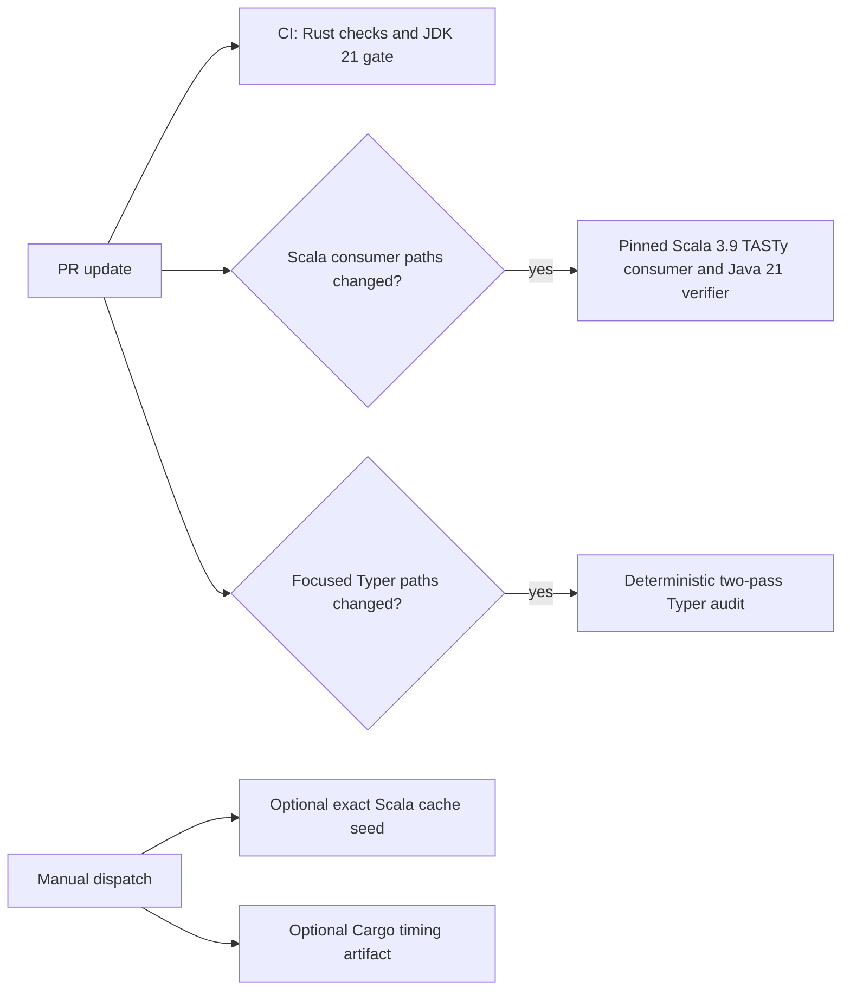

# CI performance integration results: phase 2 (#1771)

Recorded 2026-10-27. **Decision: retain the current CI configuration.** Across issues #1765–#1770, only the manually seeded, exact-key Scala build cache showed a successful first-new-PR reuse; it is opt-in and preserves all verification. The proposed Rust test-profile, integration-target, and Nextest changes did not establish a safe, repeatable net win. A larger runner is unavailable to this personal-account repository and was not benchmarked. No normal workflow, test profile, test target, or runner label changed in this phase.

This is an integration of independent experiments, not a new paired benchmark of one combined candidate. Their source SHAs, hosts, target-cache states, and triggered workflows differ. The report keeps those measurements separate and does not treat their deltas as additive.

## Decisions across the six experiment issues

| Issue / outcome | Evidence and configuration | Integration decision |
| --- | --- | --- |
| [#1765 — blocked](https://github.com/scytrowski/dotty-rs/issues/1765), [PR #1772](https://github.com/scytrowski/dotty-rs/pull/1772) | Pinned Rust 1.98.1 at opt-level 0 reproduces stack overflow in both the allowed-depth and over-depth classloader tests on the default test-thread stack. The recursive `load_uncached_class` frame is 14,216 bytes; a 256-level chain consumes enough stack before the depth error is returned. A larger diagnostic stack is not a fix. At opt-level 1, all 453 classloader unit tests (449 passed, 4 ignored) and workspace tests pass. | **Blocked** on a safe stack-safety correction. Preserve the 256-depth/error contract and current test profile. A bounded iterative hierarchy worklist is a separate follow-up; do not claim opt-level 0 is globally compatible. |
| [#1766 — rejected profile candidates](https://github.com/scytrowski/dotty-rs/issues/1766), [PR #1775](https://github.com/scytrowski/dotty-rs/pull/1775) | Same local host, source basis, Rust 1.98.1, warm registry, fresh target directories, and `CARGO_INCREMENTAL=0`, `CARGO_PROFILE_TEST_DEBUG=0`. Opt-level 1 clean build: 102.033 s; three warm full-suite runs had 15.938 s median and each passed (7,063 passed, 18 ignored). Global opt-level 0 built in 21.313 s but aborted after 64.736 s. Selective overrides also failed: classloader=1 aborted in core after 275.061 s; classloader=1/core=1 aborted in tasty-unpickler after 342.344 s. | **Rejected.** Keep `[profile.test] opt-level = 1`. Faster compilation is not a candidate if the full test suite aborts; the failed candidate runs are not timing wins. |
| [#1767 — target-consolidation POC rejected](https://github.com/scytrowski/dotty-rs/issues/1767), [PR #1777](https://github.com/scytrowski/dotty-rs/pull/1777) | Same source SHA/host/profile and fresh target dirs. A four-target `dotty-tasty-pickler` POC reduced test executables 153→150 and bytes by 1.27%, but cold compile rose 109.662→115.026 s (+4.89%). Three suite runs per state were equivalent after mapping 84 module-prefixed test names; combined compile plus run rose 125.891→131.227 s (+4.24%). Each state passed 7,064 tests and ignored 18. | **Rejected and reverted.** Preserve separate targets, names, and test-selection behavior. Fewer binaries did not shorten the measured workspace critical build-plus-run path. The experiment's dedicated JDK 21 gate was not run; the temporary POC is not in the final tree. |
| [#1768 — exact Scala cache seed validated](https://github.com/scytrowski/dotty-rs/issues/1768), [PR #1779](https://github.com/scytrowski/dotty-rs/pull/1779) | Existing manual workflow seeded the exact pinned Scala 3.9.0 target key on trusted `main`; a genuinely fresh PR restored the 643,180,765-byte (~613 MiB) entry in about 6 s. In this one pair, Scala staging was 4m49s on the cold seed and 1m17s on the fresh PR; full consumer job was 11m50s and 10m00s respectively. Both runs passed strict Scala/TASTy and Java 21 gates. | **Adopted as an opt-in manual seed only.** No new automatic job or workflow change. This is one cold-main/fresh-PR pair, not a median or proven PR-to-green saving; repeat before expanding automation. Keep exact source/JDK/build-definition keying and checksum/test gates. |
| [#1769 — Nextest not adopted](https://github.com/scytrowski/dotty-rs/issues/1769), [PR #1780](https://github.com/scytrowski/dotty-rs/pull/1780) | At source head `9ae361c084f871121b690678427f0f0bb8fbcde4`, test identity sets matched exactly: 7,089 identities (7,071 runnable, 18 ignored). Three warm runs: libtest median 35.208 s, Nextest at 16 threads 28.586 s. One clean-target build-plus-run pair was 146.573 s vs 140.002 s (4.5%); Nextest archive download/extraction took 1.8 s and was excluded from that pair. Host load varied from 4.65 to 25.12. A deliberate failing test propagated under both runners. | **Rejected for normal CI.** Warm execution alone is not the complete cost; one noisy clean-target pair does not establish a repeatable net win including installation. Keep `cargo test --workspace --all-targets --locked`. |
| [#1770 — larger runner deferred](https://github.com/scytrowski/dotty-rs/issues/1770), [PR #1782](https://github.com/scytrowski/dotty-rs/pull/1782) | Public `ubuntu-latest` is 4 vCPU/16 GB and free for this public, personal-user-owned repository. GitHub larger runners require an eligible organization/enterprise plan. A recent Rust job was 6m07s, with 1m16s before job start and 7m23s to the last CI job. No paid candidate was available or run. | **Deferred/no-go.** Retain the free runner and all checks. The illustrative 8-core charge at unchanged duration is $0.154 per Rust job/$15.40 per 100 jobs; this is not a measured candidate result. No billing change or paid job. See the [runner feasibility report](ci-runner-cost-1770.md). |

## Comparable build, execution, cache, and memory evidence

The strongest controlled Rust CI comparison remains the earlier same-commit experiment from [#1741](ci-performance-results-1741.md): Rust 1.98.1, `ubuntu-latest`, identical complete Rust checks, commit `287880316cebe239e5ea7c754bcb77038e93d6a4`, and three runs per cache strategy. The dependency-only cache produced a 6m47s median Rust-job wall time (5m51s–7m16s) versus 10m38s with the full target cache. Median restore was 2 s versus 1m38s; the cache archive decreased from 5.27 GB to 27.0 MB. All six runs passed. This establishes the cache strategy's result for that workload; it does not measure any runner-size or test-profile change in #1765–#1770.

The clean-build/test split in #1766 is local, not hosted: on Debian x86_64 with a Ryzen 9 7940HS, 16 logical CPUs, and 29 GiB RAM, the opt-level-1 clean all-target build was 102.033 s and the following full test run had a 15.938 s median. The max single-child RSS was 1,739 MiB during build and 403 MiB during test. The Cargo timing HTML records parallel compile units; overlapping unit times must not be summed, and the hosted `Run tests` step combines compilation/linking with execution. No hosted measurement currently separates those components or reports peak RSS, CPU throttling, or disk I/O.

The target-consolidation and Nextest experiments also used a local 16-CPU/29-GiB host. They answer different questions and use different source snapshots and test inventories. #1767's 7,064 test count and #1769's 7,089 identities must not be compared as a before/after count: the latter is from a later commit and uses binary/test/kind identity across discovered harnesses. All source reports retain their own raw inventory, Cargo JSON, logs, or timing HTML; links are in the table above.

## Scala cache, JVM gate, focused audit, and PR-to-green

The main-seeded Scala cache result is intentionally one observation. The fresh PR restored the exact cache from `refs/heads/main`, staged the pinned Scala revision, and then ran the unchanged strict Scala/TASTy consumer and Java 21 verifier. The later cache work adds a reusable manual path for first-time PRs; it does not skip validation. In the prior #1741 warm Scala cache experiment, three warm consumer jobs had a 7m58s median, while its first cold run took 16m58s. That PR-scoped cache experiment (about 1.01 GB of additional cache entries) is a separate configuration and sample from the exact main-seed result; don't combine the medians.

The historical PR-to-last-check baseline in [#1741](ci-performance-results-1741.md) is four PR updates with a median 11m07s and range 10m12s–18m50s; CI, Scala consumer, and sometimes the path-filtered Typer audit were included. Later path-specific snapshots were 9m03s and 8m55s, but triggered different workflow sets and are not a paired final-configuration distribution. The table below adds the latest complete PR-to-green observation available for the accepted main-seeded Scala cache path. It is one warm-first-PR sample, not a repeated distribution or a causal comparison against a fresh PR with no main seed.

| Sample and fixed input | Cache state and applicable workflows | Queue, job wall, and PR-to-green | Interpretation |
| --- | --- | --- | --- |
| Historical #1741 baseline: four PR updates | CI plus Scala consumer, with focused Typer audit on matching paths; cache states varied or were not all known | PR-to-last-check median 11m07s (10m12s–18m50s) | Context only; mixed source SHAs and workflow sets, so it is not a paired counterfactual for the cache seed. |
| Fresh PR #1779, head `794a975cc2ae7246b89e8f25f2cde8e826e09252`, merge SHA `0abc74a0cd381dfdb14192b9a359cdab467937af` | Rust cache full hit (27,026,142 B); JVM cache hit (26,896,335 B); exact main-seeded Scala key hit (643,180,765 B, ~613 MiB, restored in about 6 s). CI and Scala consumer both ran and passed; focused Typer audit did not match the changed paths. | Both workflows were created at 12:11:57 UTC. First runner logs began about 3 s later. Rust checks finished at 12:20:53 (about 8m52s job wall); JVM gate took about 2m09s and ran concurrently. Scala consumer finished at 12:21:59 (about 10m00s job wall). Summed job wall was about 21m01s; the PR-to-last-applicable-green path was **10m02s** from workflow creation. | One recent, complete path at a fixed PR SHA on the retained configuration. The one-off path is 1m05s below the historical median, but the different workflow mix/source revision means this does not establish a speedup. [CI run 40501882250](https://github.com/scytrowski/dotty-rs/actions/runs/40501882250), [Scala run 40501882230](https://github.com/scytrowski/dotty-rs/actions/runs/40501882230). |

For cache cold/warm context, the matching manual `main` seed run [40500931608](https://github.com/scytrowski/dotty-rs/actions/runs/40500931608) missed the exact Scala key, staged in 4m49s, and took 11m50s for the consumer workflow; the fresh PR above staged in 1m17s and took 10m00s. This is a one-pair cache-seed observation, not a whole-PR before/after comparison: the cold seed was a manual main-only workflow and had no concurrent PR CI path. A recent same-PR-SHA run with the main seed absent is unavailable because that cache entry already existed. Keep the unseeded-versus-seeded PR-to-green effect outstanding until a comparable fresh-PR control is available; do not remove a valid main cache entry just to manufacture one.

The recent CI-only observation in [run 40517174944](https://github.com/scytrowski/dotty-rs/actions/runs/40517174944) took 7m23s from workflow creation to its last job; it did not trigger Scala or Typer checks and is not substituted for the complete PR sample above.

The check structure remains:

The Rust cache, profile, test-target layout, Nextest, and runner experiments did not remove or weaken gates. The exact-key Scala cache is an input optimization; every cache hit still verifies source/build pins, Maven checksums, Scala/TASTy consumers, and Java 21 output.

## Correctness and CI validation

| Validation surface | Evidence and result |
| --- | --- |
| Formatting, frontend-boundary guard, Clippy, rustdoc, full Cargo workspace all-target tests, diff check | The merged #1782 head passed [CI run 40530208657](https://github.com/scytrowski/dotty-rs/actions/runs/40530208657); both Rust checks and Classfile JVM encoder gate succeeded. The latest Rust-profile baseline in #1766 passed the full suite three times; #1767's baseline and POC each passed three times with inventory parity. |
| Strict JDK 21 class-file verification | Passed in the #1772 CI run [40485748612](https://github.com/scytrowski/dotty-rs/actions/runs/40485748612); the JVM gate also passed in the #1782 CI run above. #1767's temporary POC experiment did not separately run this gate and was reverted. |
| Pinned Scala 3.9 / TASTy consumer, source and Maven checksums | Passed on the #1772 tree in [run 40485748782](https://github.com/scytrowski/dotty-rs/actions/runs/40485748782), and on both the main-seed and fresh-PR runs documented in [#1768's report](ci-performance-baseline/issue-1768-scala-cache-seed.md). Cache hits did not skip these checks. |
| Focused deterministic Typer audit | Passed on the #1772 tree in [run 40485748657](https://github.com/scytrowski/dotty-rs/actions/runs/40485748657). Its separate repeated/candidate timings are in [#1739's report](typer-ci-overhead-1739.md); a hosted full-corpus Typer audit was not run. |
| Test identity and failure propagation | #1767 preserved inventory after explicit name-prefix mapping; #1769 found zero identity-set differences and verified a controlled failing test exits unsuccessfully under both runners. Earlier negative-control [run 40472697314](https://github.com/scytrowski/dotty-rs/actions/runs/40472697314) showed the Rust CI job fails on an intentional panic while the independent JVM job still passes. |

Across the phase, suite counts differ by source revision and harness shape. The reported passing counts are retained with their own experiment rather than interpreted as a regression or increase. There was no full-corpus Typer run, no paid runner, no self-hosted runner, no cache/checksum bypass, and no time-threshold assertion.

## Reproduction, interactions, and rollback

- Start with [#1741's same-commit cache comparison](ci-performance-results-1741.md) and run links for the controlled Rust wall-time comparison.
- Use the [#1766 commands and four preserved Cargo timing reports](ci-performance-results-1766.md) to reproduce each profile with Rust 1.98.1, warm registry, and isolated fresh target paths. Run both the full build and suite; do not stop at `--no-run`.
- Use the [#1767 report and archived inventory](ci-performance-baseline/issue-1767-no-go.md) for exact test names/statuses and before/after artifacts.
- Dispatch the existing pinned Scala consumer on trusted `main`, then run it on a genuinely fresh PR to reproduce the [#1768 cache test](ci-performance-baseline/issue-1768-scala-cache-seed.md). Verify the source SHA, JDK/build-definition key, cache version/source, and every downstream gate.
- Follow the [#1769 report and evidence archive](ci-performance-baseline/issue-1769-nextest-vs-libtest.md) for the same-SHA test identity comparison, separate warm-run and clean-target runs, and runner-install cost.
- Follow the [#1770 report](ci-runner-cost-1770.md) only if an eligible larger runner and explicit spending authorization become available. Do not use local CPU affinity as hosted-runner evidence.

The experiments interact: changing test profile invalidates test artifacts and can move stack failures into other packages; target consolidation changes the harness/module identity and compile graph; Nextest changes execution scheduling and adds installation cost; runner comparisons only make sense with identical build, test, and cache inputs. The cache-only Scala seed is independent of those Rust test decisions. Therefore there is no single “phase 2 candidate” whose component savings can be added together.

No CI configuration needs rollback from this phase. Keep the current Rust profile and Cargo test command, the original test targets, all `ubuntu-latest` runner labels, and current verification workflows. If the pinned Scala seed cache is evicted, repeat the existing manual dispatch on trusted `main`; do not add an automatic seed workflow without repeated evidence of net PR-to-green benefit. The next measured cost center remains hosted Rust test-target build/link time; split compilation from actual test execution using the manual Cargo timing artifacts before proposing another persistent CI change.
